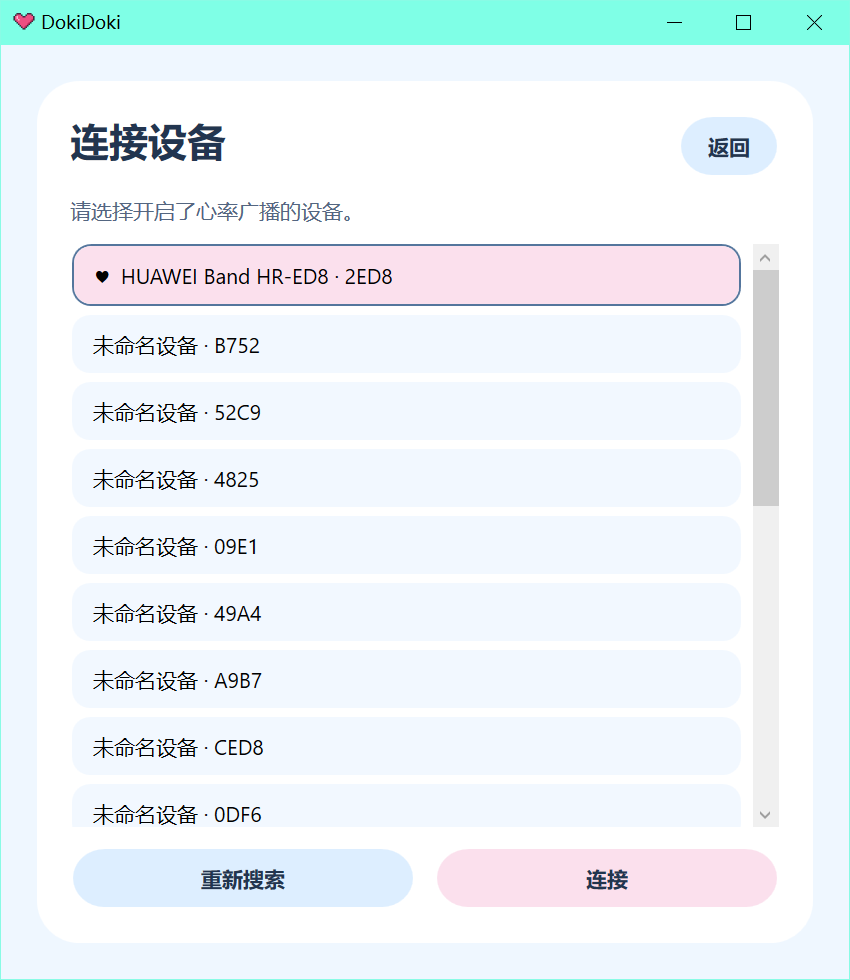
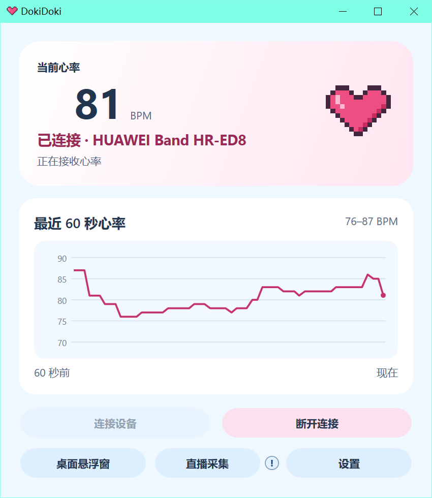
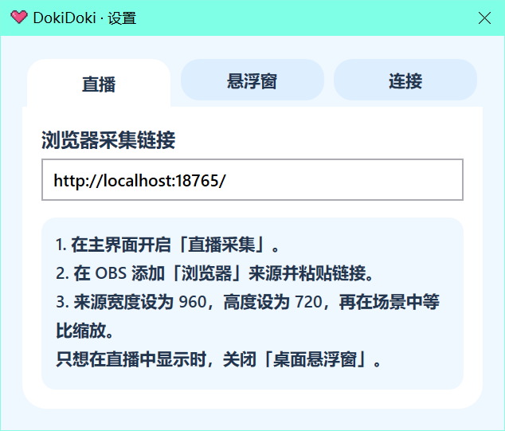
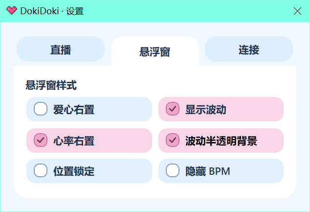
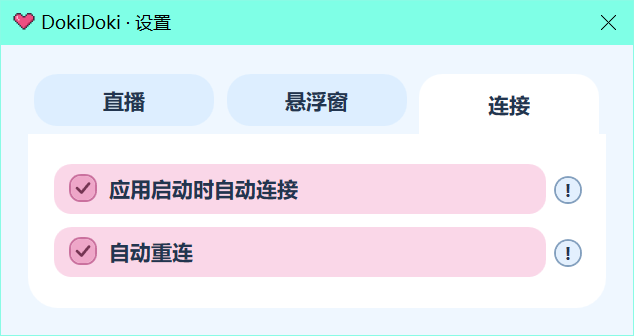
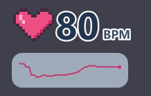

<div align="center">
  
  <h1>DokiDoki</h1>
  <p>通过蓝牙接收手环实时心率的 Windows 桌面应用</p>
  <p>实时 BPM · 最近 60 秒趋势 · 桌面悬浮窗 · OBS 浏览器采集</p>
</div>

DokiDoki 使用标准 BLE 心率服务连接开启心率广播的穿戴设备，在主窗口、桌面悬浮窗和本机浏览器采集页面中展示当前心率。桌面界面采用 C#、.NET 10 和 WPF，发布目标为 Windows x64。

## 目录

- [功能概览](#功能概览)
- [界面展示](#界面展示)
- [运行要求与兼容性](#运行要求与兼容性)
- [快速开始](#快速开始)
- [功能使用说明](#功能使用说明)
- [OBS 直播采集](#obs-直播采集)
- [数据与当前限制](#数据与当前限制)
- [常见问题](#常见问题)
- [开发与发布](#开发与发布)
- [项目结构与实现](#项目结构与实现)
- [反馈与贡献](#反馈与贡献)
- [开源协议](#开源协议)

## 功能概览

| 功能 | 当前实现 |
| --- | --- |
| 设备发现 | 扫描附近 BLE 广播，按地址去重，优先显示声明心率服务的设备 |
| 实时心率 | 订阅心率通知，显示设备名称、连接状态和 BPM |
| 心率趋势 | 滚动显示最近 60 秒有效读数，并标注该时间段的最小值与最大值 |
| 像素爱心 | 主窗口与桌面悬浮窗根据心率区间平滑改变跳动节奏 |
| 桌面悬浮窗 | 透明、置顶、可拖动，可锁定位置并让鼠标点击穿透 |
| 显示设置 | 调整爱心和心率的左右顺序、曲线显示及曲线半透明背景 |
| 直播采集 | 向同一台电脑上的 OBS 提供透明浏览器来源，可独立于桌面悬浮窗开启 |
| 断开处理 | 检测蓝牙断开或连续 15 秒没有有效读数，清空显示并提示重新连接 |

## 界面展示

<table>
  <tr>
    <th>连接设备</th>
    <th>实时心率与趋势</th>
  </tr>
  <tr>
    <td></td>
    <td></td>
  </tr>
</table>

<table>
  <tr>
    <th>直播设置</th>
    <th>悬浮窗设置</th>
    <th>连接设置</th>
  </tr>
  <tr>
    <td></td>
    <td></td>
    <td></td>
  </tr>
</table>

<p align="center"></p>

悬浮窗截图中的深色区域是截图背景；应用悬浮窗本身透明，曲线区域可单独启用半透明底色。

## 运行要求与兼容性

- **电脑**：Windows x64，具备可用的 BLE 蓝牙适配器并开启蓝牙。
- **设备**：能够开启心率广播，并提供标准心率服务 `0x180D`、心率测量特征 `0x2A37` 和通知能力。能被扫描到不代表一定能接收心率。
- **运行程序**：项目采用自包含单文件发布配置，按该配置生成的程序包含 .NET/WPF 运行时，无需另装 SDK。
- **开发源码**：需要 .NET 10 SDK；具体版本选择见 [global.json](global.json)。

目标运行环境为 Windows 10 22H2 与 Windows 11。既有项目记录确认 WPF 版在 Windows 10 22H2 启动，Windows 11 实机兼容性仍待验证。

| 设备或广播名称 | 已有验证依据与范围 |
| --- | --- |
| 华为手环9 NFC版，`HUAWEI Band HR-ED8` | 已测试扫描、连接和心率接收；本 README 所附 WPF 实际运行截图展示设备连接、BPM 和趋势。 |
| 小米手环10 Pro，`Xiaomi 5C56` | 已测试 WPF 版连接并显示实时 BPM 和心率曲线。 |

其他型号需实机确认，不能仅凭品牌或蓝牙名称推断兼容性。

## 快速开始

1. 获取项目文件，运行`DokiDoki.exe`文件，或克隆仓库后运行根目录的 [DokiDoki.exe](./DokiDoki.exe)。
2. 打开电脑蓝牙，戴好手环并开启心率广播。已有华为设备记录中的入口为「设置 → 心率广播」，其他设备以实际菜单为准。
3. 在主窗口点击「连接设备」，等待自动搜索完成，通常约 8 秒。
4. 选中自己的设备，点击「连接」。成功后自动返回主窗口，等待首个有效读数。
5. 需要桌面展示时，点击「桌面悬浮窗」；需要 OBS 时按下文配置直播采集。
6. 使用结束后点击「断开连接」，或关闭主窗口退出。

## 功能使用说明

### 搜索与连接设备

进入「连接设备」页面会自动开始一次搜索。列表显示设备广播名称及蓝牙地址末四位，未提供名称时显示「未命名设备」。带 `♥` 的项目表示其广播中声明了心率服务，这类设备排在前面；该标记不是已连接状态。

选中设备后「连接」按钮可用。搜索或连接期间，设备选择、返回及相关操作按钮暂时禁用，待当前操作完成后恢复。列表是本次搜索的结果快照，需要更新时点击「重新搜索」；点击「返回」可回到主界面。

连接会依次打开设备、查询心率服务及测量特征、订阅通知。成功后显示约 3 秒的连接提示并回到主界面；失败原因显示在设备页面。应用一次连接一台设备，更换设备前先在主界面断开当前连接。

### 查看实时读数与趋势

- **当前心率**：显示设备传回的有效 BPM，即每分钟心跳次数。尚无读数或已断开时显示 `—`。主界面、桌面悬浮窗和 OBS 均预留三位数字空间，读数从 99 升到 100 时个位和十位保持右对齐。
- **连接状态**：显示当前设备名称；已订阅但尚无数据时提示「等待设备发送心率…」，收到有效值后提示「正在接收心率」。
- **最近 60 秒心率**：横轴从「60 秒前」到「现在」，曲线按收到读数的时间绘制，旧样本滚动移出。
- **右上角范围**：表示当前 60 秒窗口内的最小值与最大值；所有读数相同时显示单一数值。纵轴按数据范围自动调整。

读数更新频率由设备发送通知的频率决定。曲线是心率数值随时间的变化，不是心电波形。刚连接时只显示已收到的样本，不会补齐此前 60 秒数据。

### 爱心跳动

主窗口、桌面悬浮窗和浏览器采集使用同一张像素爱心图片，通过缩放产生跳动。节奏按下表分档，同一档内保持目标节奏，跨档时平滑变速；没有有效读数时停止动画。

| 当前读数（BPM） | 动画目标节奏（次/分钟） |
| --- | --- |
| 大于 0 且小于 60 | 50 |
| 60–79 | 70 |
| 80–99 | 90 |
| 100–119 | 110 |
| 120–149 | 135 |
| 150 及以上 | 160 |

这些区间仅控制视觉动画，不是健康分级，也不改变显示的实际 BPM。

### 桌面悬浮窗与样式设置

v2.0.0 的开关位于主界面底部，样式位于「设置 → 悬浮窗」。

点击主界面的「设置」打开独立窗口。「悬浮窗」页可调整显示样式，「直播」页提供采集链接和步骤，「连接」页可调整自动连接和自动重连。选项更改立即生效，无需保存；关闭设置窗口不会关闭已经开启的悬浮窗或直播采集。最小化主窗口时，已开启的桌面悬浮窗会继续置顶显示，直到手动关闭悬浮窗或退出应用。

| 选项 | 默认状态 | 使用方式与效果 |
| --- | --- | --- |
| 开启桌面悬浮窗 | 关闭 | 开启后显示透明置顶窗口；取消勾选隐藏窗口，不会断开蓝牙 |
| 开启直播采集 | 关闭 | 开启本机浏览器采集服务并显示链接，可独立于桌面悬浮窗使用 |
| 爱心右置 | 未选中 | 爱心在右、心率在左；与「心率右置」二选一 |
| 心率右置 | 选中 | 爱心在左、心率在右 |
| 显示波动 | 开启 | 显示最近 60 秒心率曲线；关闭后只保留爱心与读数 |
| 波动半透明背景 | 开启 | 给曲线添加浅色半透明底色；取消后保留曲线并使其背景透明 |
| 隐藏 BPM | 关闭 | 同步隐藏桌面悬浮窗与 OBS 的 BPM 单位，保留三位数字空间。桌面悬浮窗自动收窄，OBS 曲线及其半透明背景随读数行收窄，OBS 画布仍为 960 × 720 |
| 位置锁定 | 关闭 | 锁定桌面悬浮窗并开启鼠标穿透；仅桌面悬浮窗开启时可调整 |

**移动位置**：保持「位置锁定」关闭，按住悬浮窗内容拖动到目标位置，再勾选锁定。锁定后鼠标操作会落到下方窗口，需回到设置页面取消锁定后才能再次拖动。

桌面悬浮窗或直播采集任一开启时，样式选项即可调整；两者均关闭时，样式区域禁用。关闭「显示波动」后，背景选项暂时不可操作。左右顺序、曲线和背景同步影响两种输出；位置锁定只影响桌面悬浮窗。「悬浮窗样式」第三排左侧为「位置锁定」，右侧为「隐藏 BPM」。

「连接」页的两个开关默认开启，并保存到本机。悬浮窗与直播开关、样式及悬浮窗位置仅在当前会话内保留。

### 断开、超时与退出

点击「断开连接」会释放蓝牙连接，并清空主界面、悬浮窗和采集页面中的读数及曲线。桌面展示和采集开关仍可保持开启。

应用每约 0.5 秒检查一次连接状态。检测到蓝牙断开，或连续 15 秒没有有效读数时，会主动结束连接并提示原因。无效数据包、零值及设备报告的传感器接触丢失不会作为有效读数刷新等待时间。

意外断连或心率数据中断后，主界面和已开启的桌面悬浮窗会同时提示。开启自动重连时，主界面和已开启的悬浮窗会持续显示重连提示，最多尝试 2 分钟。启用启动自动连接时，应用会持续搜索记住的设备，直至连上或取消，无时间上限。断线重连超时会再次提示，主界面显示「已关闭自动连接」，此时可手动连接。点击「断开连接」可取消当前自动连接或重连。关闭主窗口会关闭悬浮窗和本机采集服务；若正在进行蓝牙操作，窗口会等待该操作结束后退出。

## OBS 直播采集

### 添加浏览器来源

1. 启动 DokiDoki 并连接心率设备。
2. 在主界面开启「直播采集」，再到「设置 → 直播」复制链接。
3. 在同一台电脑的 OBS 场景中添加「浏览器」来源。
4. 将设置窗口显示的地址复制到来源 URL，并使用以下尺寸。

| 设置项 | 值 |
| --- | --- |
| URL | `http://localhost:18765/` |
| 宽度 | `960` |
| 高度 | `720` |
| 页面背景 | 透明，由内置页面提供 |

5. 在 OBS 场景中等比缩放、移动来源，放到所需位置。隐藏曲线时仍保留 `960 × 720` 的来源尺寸。
6. 修改 DokiDoki 中的左右布局、曲线与背景选项，采集页面会同步更新。

### 选择展示方式

| 使用场景 | 开启桌面悬浮窗 | 开启直播采集 |
| --- | --- | --- |
| 只在自己的桌面显示 | 开 | 关 |
| 只在 OBS 场景显示 | 关 | 开 |
| 桌面与 OBS 同时显示 | 开 | 开 |

浏览器来源绘制独立页面，不需要截取桌面悬浮窗的位置或桌面背景。位置锁定不影响 OBS 来源在场景中的移动和缩放。

浏览器采集中的爱心按与桌面相同的心率分档跳动，跨档时平滑变速，无有效读数时停止。数字与 `BPM` 单位分别使用较细的白边。升级后请重启应用、重新开启直播采集，并刷新 OBS 或直播姬的浏览器来源，地址和尺寸可继续使用。

采集页约每 0.5 秒请求一次最新状态。关闭直播采集或退出 DokiDoki 后服务停止，已加载页面在后续请求失败时隐藏内容。`localhost` 指当前电脑，不能把该地址直接用于另一台电脑采集；端口当前固定为 `18765`，没有界面配置入口。

## 数据与当前限制

- 当前心率和最近 60 秒样本保存在内存中，应用没有历史记录文件、导出或云端同步功能；断开后清空样本。
- 当前实现没有账号登录或远程上传逻辑；开启直播采集时，本机浏览器可读取正在展示的心率状态。
- 一次仅连接一台设备。应用在当前 Windows 用户的本机设置目录中保存最近一次成功连接的蓝牙地址，启动时自动尝试连接。若设备重新广播时地址已改变，请手动连接一次以更新记录。
- 当前提供 Windows x64 发布配置，未提供 macOS、Linux 或 ARM64 原生发布配置。
- 桌面悬浮窗未提供自由调整字号、颜色和窗口缩放的设置；OBS 画面大小在场景中调整。

## 常见问题

| 现象 | 排查方法 |
| --- | --- |
| 扫描不到设备 | 确认电脑蓝牙与设备心率广播均开启，将设备靠近电脑后重新搜索；必要时临时断开手机蓝牙连接再试 |
| 列表里有很多未命名设备 | 列表包含附近其他 BLE 设备；根据自己的广播名称和地址末四位辨认，优先检查带心形标记的候选项 |
| 扫描到了但连接失败 | 确认设备提供标准心率服务和通知能力；重新开启广播后重扫，记录界面显示的具体错误 |
| 已连接但一直没有读数 | 检查设备佩戴接触与广播状态，等待有效通知；持续 15 秒没有有效值会断开，处理后重新连接 |
| 出现「心率数据已中断」 | 旧读数已清空，应用会自动重连。检查广播、距离和佩戴情况，超时后可手动连接 |
| 悬浮窗拖不动或点不到 | 在主窗口打开设置，取消「位置锁定」；锁定状态会让鼠标穿透 |
| 样式或背景选项变灰 | 先开启桌面悬浮窗或直播采集；要调整背景还需开启「显示波动」 |
| 直播采集无法开启 | 查看设置页的错误信息；检查是否已经运行另一份 DokiDoki、端口是否被占用或本机 HTTP 监听权限是否受限 |
| OBS 没有画面 | 确认 DokiDoki 正在运行、直播采集开启、OBS 与程序在同一电脑；在本机浏览器打开采集地址检查服务，再刷新来源 |
| OBS 图形被裁切或比例异常 | 将浏览器来源设为 960 × 720，并在场景中等比缩放；隐藏曲线后也保持该来源尺寸 |
| 重启后设置消失 | 当前版本不保存设置和悬浮窗位置，每次启动需重新开启所需功能 |

## 开发与发布

### 环境与运行

以下命令均在包含 `DokiDoki.csproj` 的目录执行。如果打开的是外层开发工作区，先进入 `DokiDoki-gh`。

安装 .NET 10 SDK。`global.json` 的基准版本为 `10.0.100`，允许滚动到同一主次版本的较新功能带，禁用预发行版本。

```powershell
# 检查可用 SDK
 dotnet --list-sdks

# 构建解决方案
 dotnet build .\DokiDoki.sln

# 启动桌面应用
 dotnet run --project .\DokiDoki.csproj
```

使用 VS Code 时，打开该项目目录并安装 Microsoft C# 扩展，在「运行和调试」中选择「运行 DokiDoki」，按 F5。现有任务会先构建；正常使用应安装 SDK，任务另保留了临时 SDK 路径的本机回退逻辑。

使用支持该项目目标框架的 Visual Studio，安装「.NET 桌面开发」工作负载，打开 `DokiDoki.sln` 后运行。

### 发布单文件程序

```powershell
dotnet publish .\DokiDoki.csproj -c Release -r win-x64 --self-contained true -o .\publish
```

项目已启用单文件发布、压缩和原生库自解压，默认产物为 `publish/DokiDoki.exe`。仓库根目录提供 `DokiDoki.exe`，v2.0.0 发行包中的文件名为 `DokiDoki-v2.0.0.exe`。

### 验证改动

当前项目未提供自动化测试项目。涉及连接或界面行为的改动，应在具备 BLE 的 Windows 电脑上检查：搜索并连接设备、首个读数与趋势、主动断开、停止广播后的超时处理、重新连接、悬浮窗拖动与锁定、主窗口最小化时悬浮窗保持显示、OBS 单独开启以及关闭主窗口后的服务停止。涉及动画时还需观察跨心率区间的变化。

## 项目结构与实现

```text
DokiDoki-gh/
├── Backend/
│   ├── BleHeartRateService.cs       # 扫描、连接、订阅与释放蓝牙资源
│   ├── BleMeasurement.cs            # WinRT 异步转换与心率数据解析
│   └── ObsCaptureServer.cs          # 本机浏览器采集 HTTP 服务
├── Frontend/
│   ├── Assets/
│   │   ├── Heart.png / Heart.ico    # 爱心图片与应用图标
│   │   └── ObsOverlay.html          # 透明浏览器采集页面
│   ├── App.xaml / App.xaml.cs       # WPF 应用入口
│   ├── HeartRateWindow.xaml[.cs]    # 主界面、设备页面与会话协调
│   ├── HeartRateOverlay.xaml[.cs]   # 桌面悬浮窗与鼠标穿透
│   ├── OverlaySettingsWindow.xaml[.cs] # 即时设置与采集开关
│   ├── HeartRateTrend.cs            # 共享趋势绘制
│   ├── PulsingHeart.cs              # 爱心缩放与分档平滑变速
│   └── OutlinedText.cs              # 悬浮窗描边文字
├── docs/images/                    # README 实际运行截图
├── .vscode/                        # 本地构建与调试配置
├── DokiDoki.exe                      # 当前预编译程序
├── DokiDoki.csproj                 # 框架、资源及发布配置
├── DokiDoki.sln                    # 解决方案
├── global.json                     # SDK 版本选择
├── LICENSE                         # MIT 开源协议
└── README.md
```

`*.xaml[.cs]` 表示 XAML 文件及其对应的 `.xaml.cs` 文件。

数据路径为：**BLE 广播发现 → GATT 服务与特征查询 → 通知解析 → 主窗口内存样本队列 → 主界面、悬浮窗与浏览器状态同步**。前后端编译到同一个桌面程序；前端负责显示和会话状态，蓝牙后端不依赖 WPF 界面。

`BleMeasurement` 支持 8 位和 16 位 BPM，过滤长度不足、零值及传感器明确报告接触丢失的数据。`ObsCaptureServer` 提供 `/` 页面、`/heart.png` 图片和 `/state` JSON 状态，仅处理 GET 请求。页面资源随程序嵌入，无需单独部署网页服务器。

## 反馈与贡献

反馈问题时请附上程序版本、Windows 版本、设备型号及固件、蓝牙适配器信息、复现步骤和完整错误提示。界面问题可附截图；兼容性反馈请说明扫描、连接、首个读数、持续接收及断开重连分别是否成功。

修改代码前先运行现有项目，提交改动时说明用途、涉及功能和实际验证环境。新增设备兼容记录应以实机结果为依据，并保留未验证项目的说明。

## 开源协议

本项目采用 [MIT License](./LICENSE)。

Copyright (c) 2026 Rozen

允许使用、复制、修改、分发及商业使用；分发本软件副本或其实质性部分时，须保留版权声明和许可声明。本软件按“原样”提供，不作任何担保，完整条款请参阅 [LICENSE](./LICENSE)。
